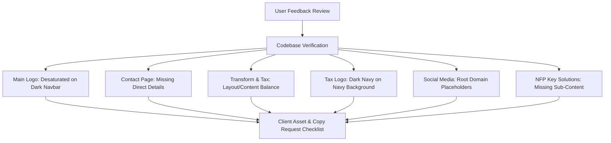

# EVOLVE Corporate & Business Solutions
## Website Feedback Evaluation & Client Information Request Document

**Document Version:** 1.0  
**Date:** November 2, 2026  
**Status:** Validated / Ready for Client Engagement  

---

## 1. Executive Summary

This document consolidates and validates the 6-point review feedback for the **EVOLVE Corporate & Business Solutions** web platform. All 6 feedback items were verified against the current React/Tailwind codebase, confirming that each point highlights a genuine visual, structural, or brand discrepancy. 

To maintain strict adherence to project standards:
1. **Zero-Hallucination Content Rule**: No synthetic copy or placeholder text will be fabricated. Missing copy will be gathered directly from the client.
2. **Executive Brand Integrity**: Visuals and logos must remain fully aligned with senior practitioner-led advisory standards.
3. **No Unapproved Changes**: No codebase alterations have been made during this evaluation turn.

---

## 2. Technical Evaluation & Codebase Verification

### Point 1: Main Logo Should Be Colorful
* **Feedback:** "Main Logo should color full."
* **Codebase Verification:** Validated.
  * *Current Implementation:* In `Header.jsx`, the primary navigation invokes `BrandLogo variant="dark"`, which points to `/Logo/evolve-corporate-business-solutions-white.svg`. In this SVG asset, the wordmark letters (`EVOLVE`) and the tagline (`Corporate & Business Solutions`) are flat white (`#ffffff`). Only the geometric "V" folds contain color, resulting in a monochromatic look on the dark header.
  * *Resolution Path:* Replace with an official full-color variant that retains maximum brand color impact on dark navy backgrounds (`#061a2e`).

### Point 2: Contact Page Direct Contact Details
* **Feedback:** "Contact page should include contact details."
* **Codebase Verification:** Validated (Critical).
  * *Current Implementation:* In `ContactPage.jsx`, the page consists exclusively of a hero banner and an enquiry form (`How can we help?`, `Organisation`, `Your Name`, `Work Email`, `Message`).
  * *Gap:* The page lacks standard corporate advisory contact data (telephone number, dedicated general enquiry email, office/city locations, and business operating hours).
  * *Resolution Path:* Add a structured two-column layout with a dedicated "Direct Contact & Executive Offices" information card beside or above the form.

### Point 3: UI Fit & Content Expansion (Transform & Tax Pages)
* **Feedback:** "Provide better design, need add some content.according to the current content UI not fit. Ex: Transform and tax page"
* **Codebase Verification:** Validated.
  * *Transform Page (`TransformPage.jsx`):* The *Data Integration* section features 8 two-word labels (`Data mapping`, `Migration`, `Data structures`, etc.) placed inside large cards, leaving substantial empty space.
  * *Tax Page (`ProtectPage.jsx`):* The core modules display 5–6 brief bullet items paired with large character illustrations. The layout is unbalanced relative to the sparse copy.
  * *Resolution Path:* Collect 1–2 authoritative explanatory sentences or sub-bullets per service area from the client, and adjust the card grid to ensure clean typography and visual balance.

### Point 4: Dedicated Taxation & Advisory Logo for Dark Theme
* **Feedback:** "According to the current theme, need different tax and advisory logo"
* **Codebase Verification:** Validated (Urgent Visual Bug).
  * *Current Implementation:* In `Header.jsx`, navigating to the Tax & Compliance page switches the navbar logo to `evolve-taxation-advisory.svg`. In this SVG, the text fill is dark navy (`#0B2F45`).
  * *Issue:* Against the dark navy header (`#061a2e`), the text is virtually invisible. The only alternative in the repository (`evolve-taxation-advisory-white-bg.svg`) contains an unstyled white rectangular backdrop box that breaks header aesthetics.
  * *Resolution Path:* Obtain or produce a transparent-background dark-mode vector SVG with crisp white/light lettering and brand gradients.

### Point 5: Share Social Media Links
* **Feedback:** "share social media link."
* **Codebase Verification:** Validated.
  * *Current Implementation:* In `FooterCTA.jsx`, social icons are hardcoded to generic domain roots (`https://linkedin.com` and `https://youtube.com`).
  * *Resolution Path:* Replace placeholders with the firm's verified company handles and profile URLs.

### Point 6: Sub-Content for Not-for-Profit & Community Key Solutions
* **Feedback:** "If better add more sub content for each Key solutions for Not-for-Profit & Community Organisations pages."
* **Codebase Verification:** Validated (High Impact).
  * *Current Implementation:* In `NotForProfitPage.jsx`, the 9 Key Solution cards (CFO Advisory, Budgeting & Forecasting, Cash-Flow Management, Board Reporting, Funding & Grant Reporting, NDIS Financial Management, Financial Modelling, Health Checks, Transformation) display only a header image, icon, and bare title.
  * *Issue:* The lower portion of each card is completely blank, producing an unfinished look.
  * *Resolution Path:* Incorporate 1–2 sentences or 2–3 concise deliverables per card once provided by the client.

---

## 3. Client Information & Asset Request Checklist

The following communication template can be sent directly to the customer:

> ### Information & Asset Request for EVOLVE Website Finalization
> 
> **1. Brand Assets & Logos**
> * [ ] **Primary Brand Logo:** Full-color vector SVG optimized for dark navy (`#061a2e`) backgrounds.
> * [ ] **Taxation & Advisory Logo:** Dark-theme vector SVG for "EVOLVE Taxation & Advisory" with white/light lettering on a transparent background.
> 
> **2. Corporate Contact Details**
> * [ ] **Phone Number:** Primary corporate or reception contact number.
> * [ ] **Enquiry Email:** Official general enquiry or advisory email address (e.g., `info@...` or `enquiries@...`).
> * [ ] **Office Locations:** Physical street address(es), postal address, or principal operating cities (e.g., Sydney, Melbourne, Brisbane).
> * [ ] **Operating Hours:** Client support/consultation availability (e.g., Mon–Fri, 8:30 AM – 5:30 PM AEST).
> 
> **3. Social Media Channels**
> * [ ] **LinkedIn:** Official EVOLVE corporate company page URL.
> * [ ] **Other Platforms:** Direct URLs for YouTube, X/Twitter, or other active business channels.
> 
> **4. Service Content Clarifications**
> * [ ] **Not-for-Profit & Community Solutions:** 1–2 explanatory sentences or 2–3 key bullet deliverables for each of the 9 solutions:
>   1. *CFO Advisory & Financial Sustainability*
>   2. *Budgeting & Forecasting*
>   3. *Cash-Flow Management*
>   4. *Board Reporting*
>   5. *Funding and Grant Reporting*
>   6. *NDIS Financial Management*
>   7. *Financial Modelling*
>   8. *Finance Health Checks*
>   9. *Finance Transformation & Reporting Analytics*
> * [ ] **Transform Page (Data Integration):** 1–2 descriptive lines for key elements (Data mapping, System integration, Data models, Chart of accounts) to balance card dimensions.
> * [ ] **Tax & Compliance Page (Protect):** Any specific scope descriptions or preferred bullet expansions for Business Taxation, BAS/GST, Payroll/Super, and FBT.

---

## 4. Proposed Implementation Plan

| Phase | Task Description | Dependencies |
|:---|:---|:---|
| **Phase 1: Brand Assets** | Update `BrandLogo.jsx` and vector assets with full-color primary logo and white-text Taxation & Advisory SVG. | Client logo files |
| **Phase 2: Contact Page** | Introduce an executive contact card on `ContactPage.jsx` with direct phone, email, address, and hours. | Client contact info |
| **Phase 3: Social Links** | Update `FooterCTA.jsx` with official corporate social profile URLs. | Client social links |
| **Phase 4: NFP Solutions** | Populate descriptions across all 9 cards on `NotForProfitPage.jsx`. | Client copy input |
| **Phase 5: Transform & Tax UI** | Rebalance card padding, typography, and content density on `TransformPage.jsx` and `ProtectPage.jsx`. | Client service details |
