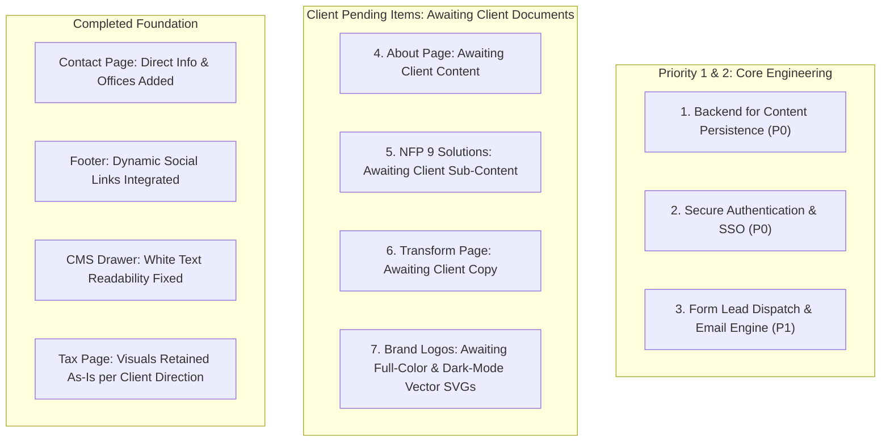

# EVOLVE Corporate & Business Solutions
## Project Pending Tasks & Master Roadmap Tracker

**Last Updated:** November 3, 2026  
**Status:** Living Master Document  
**Strict Rule Enforced:** Zero unauthorized code or content additions. Only canonical documents provided by the client are used. All missing copy remains pending until supplied by the client.

---

## Executive Overview

---

## 1. Technical & Architectural Pendings

### 1.1 Backend for Saving Section Content (Priority #1)
* **Status:** Pending Backend Integration
* **Current State:** 
  * The in-browser CMS (`CMSDrawer.jsx`, `App.jsx`, `initialData.js`) saves changes to the browser's `localStorage` (`evolve_site_data`).
  * Edits made by an administrator do not yet sync to an external database across different browsers, devices, team members, or production visitors.
* **Pending Requirements:**
  * [ ] Design database schema / content store (e.g., Supabase PostgreSQL, Firebase Firestore, SQLite, or headless CMS).
  * [ ] Build REST / Serverless API endpoints (`GET /api/content`, `PUT /api/content/:section`) with validation.
  * [ ] Implement cloud asset upload handling.

### 1.2 Authentication & Security Infrastructure (Priority #2)
* **Status:** Pending Security Implementation
* **Current State:**
  * `AdminLoginModal.jsx` and `ssoAuth.js` use static mock accounts from `dummyAdminUsers.js` and store a simulated session token in `localStorage`.
* **Pending Requirements:**
  * [ ] Implement real authentication provider (e.g., Supabase Auth, Auth0, Firebase Auth, or JWT with secure HTTP-only cookies).
  * [ ] Enforce password hashing (bcrypt / Argon2) and secure session invalidation.
  * [ ] Configure Role-Based Access Control (RBAC): Admin vs. Editor.

### 1.3 Form Processing & Lead Delivery Engine
* **Status:** Pending Integration
* **Current State:**
  * `ContactPage.jsx` and `ContactModal.jsx` simulate enquiry submission.
* **Pending Requirements:**
  * [ ] Connect form submissions to transactional email service (e.g., Resend, SendGrid, Postmark).
  * [ ] Dispatch email notifications to EVOLVE partners on submission.

---

## 2. Items Awaiting Client Documents / Inputs (NO INVENTED COPY)

### 2.1 About Page
* **Status:** Pending Client Copy
* **Current State:**
  * `AboutPage.jsx` strictly matches the canonical document:
    * "Experience Across Complex Organisations" (7 dimensions)
    * "How We Work" (4 principles)
    * "Our Philosophy" (3 pillars: Clarity, Capability, Change)
* **Pending Requirement:**
  * [ ] Awaiting client-provided document for any additional sections (e.g. bios, history, or credentials). **Do not invent or add unapproved profiles.**

### 2.2 Not-for-Profit & Community Organisations
* **Status:** Pending Client Copy
* **Current State:**
  * `NotForProfitPage.jsx` strictly matches the canonical document:
    * 9 Key Solutions (Titles only, as defined in `not-for-profit-source-of-truth.md`)
    * 7 Key Governance Questions
* **Pending Requirement:**
  * [ ] Awaiting client-provided deliverables / descriptions for the 9 solutions. **Do not invent synthetic sub-content.**

### 2.3 Transform Page UI Density Rebalance
* **Status:** Pending Client Copy
* **Pending Requirement:**
  * [ ] Awaiting client descriptions for the 8 Data Integration dimensions.

### 2.4 Brand Logos
* **Status:** Awaiting Client Vector SVG Assets
* **Pending Requirements:**
  * [ ] Main Logo: Full-color vector SVG.
  * [ ] Tax & Advisory Logo: Dark-mode vector SVG with white/light text.

---

## 3. Confirmed Completed Items

| Item | Details |
|:---|:---|
| **CMS Drawer Field Text Visibility** | Fixed: all inputs now explicitly styled with dark slate `#0f172a` text on `#ffffff` backgrounds. |
| **Contact Page Direct Details** | Split layout with telephone, official email, operating hours, offices (Sydney, Melbourne, Brisbane), and confidentiality notice. |
| **Social Media Links** | Added dynamic LinkedIn, YouTube, and X support to `FooterCTA.jsx` and CMS Drawer. |
| **Tax Page Characters** | Retained as-is per client directive ("No need this"). |

---

## Master Priority Table

| ID | Item | Priority | Status |
|:---:|:---|:---:|:---|
| **01** | Backend content saving (DB / API) | **P0 (Top Priority)** | Pending Architecture |
| **02** | Real Authentication & session management | **P0 (Top Priority)** | Pending Architecture |
| **03** | Form email notifications | **P1 (High)** | Pending Service Setup |
| **04** | About Page additional content | **P1 (High)** | Awaiting Client Document |
| **05** | Not-for-Profit solutions sub-content | **P1 (High)** | Awaiting Client Document |
| **06** | Logo vector SVGs (Main & Tax) | **P0 / P1** | Awaiting Client Vector Assets |
| **07** | Contact Page & CMS Drawer field visibility | **P0** | ✅ **Completed** |
| **08** | Tax page visuals retained | **N/A** | ✅ **Completed (Retained As-Is)** |
